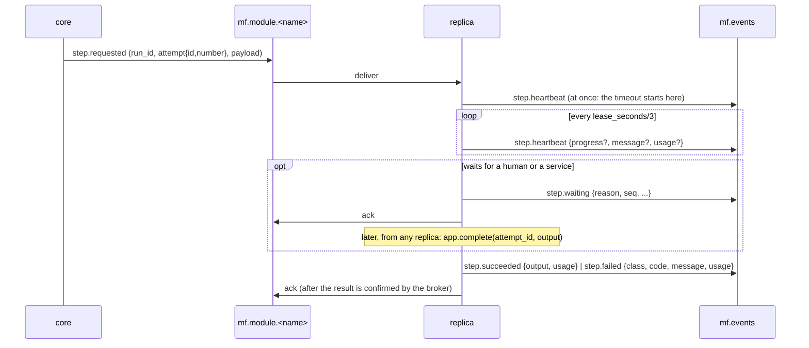

# Протокол модулей (contract 0.3.0)

Документ для авторов SDK и модулей. Машиночитаемая часть:
- `schemas/envelope/v2/envelope.schema.json`: конверт и payload каждого типа;
- `schemas/envelope/v2/blob-ref.schema.json`: ссылка на blob;
- `testdata/envelope/{valid,invalid}`: примеры, которые SDK должен принимать и отвергать так же, как ядро;
- `testdata/envelope/step_key.json` и `message_ids.json`: тест-векторы производных идентификаторов.

Go-реализация лежит в `internal/contract`. Изменения 0.3.0 и их причины: `docs/adr/0013-confirm-and-module-tokens.md`, `docs/adr/0014-waiting-and-on-timeout.md`.

## 1. Окружение модуля

Runtime-драйвер (docker, kubernetes) задаёт эти переменные каждому контейнеру. Для `runtime: external` их задаёт тот, кто запускает модуль.

| Переменная | Пример | Смысл |
|---|---|---|
| `MF_MODULE_NAME` | `hello-hello` | имя ресурса Module |
| `MF_REPLICA_ID` | `hello-hello-0` | уникален среди живых реплик; если не задан, SDK генерирует `<module>-<random>` |
| `MF_AMQP_URL` | `amqp://mod-hello-hello:…@rabbitmq:5672/` | брокер; пользователь брокера равен модулю |
| `MF_CONCURRENCY` | `4` | prefetch = число одновременных шагов в реплике |
| `MF_HEALTH_ADDR` | `:8081` | адрес для `/healthz`, `/readyz` и `/metrics` |
| `MF_S3_ENDPOINT`, `MF_S3_BUCKET`, `MF_S3_ACCESS_KEY`, `MF_S3_SECRET_KEY`, `MF_S3_TLS` | `minio:9000`, `mf-blobs`, …, `false` | хранилище blobs |
| `MF_CORE_URL` | `http://manufacture:8080` | gateway ядра; нужен только для `confirm` (§4.6) |
| `MF_MODULE_TOKEN` | `mft_…` | токен модуля для `confirm`; драйвер монтирует его файлом секрета и не читает |
| `MF_LOG_LEVEL` | `info` | |
| `OTEL_EXPORTER_OTLP_ENDPOINT` | `http://otel:4317` | необязательно |

Префикс `MF_` зарезервирован: в `spec.env` модуля его использовать нельзя.

## 2. Топология RabbitMQ (RabbitMQ ≥ 4.0)

| Объект | Тип | Кто объявляет | Назначение |
|---|---|---|---|
| `mf.commands` | exchange direct, durable | ядро | работа модулю, ключ `module.<name>`; уведомления, ключ `notify.<name>` |
| `mf.module.<name>` | quorum queue | ядро при apply модуля; SDK объявляет повторно с **теми же** аргументами | `step.requested`, `source.trigger` |
| `mf.notify.<name>` | quorum queue | ядро при apply модуля с `subscribe`; SDK объявляет повторно | `run.started`, `run.finished` |
| `mf.control` | exchange topic, durable | ядро | `step.cancel`, `run.rejected`, ключ `control.<name>` |
| `mf.control.<name>.<replica>` | classic queue, exclusive, auto-delete | SDK | привязка `control.<name>`, по одной на реплику |
| `mf.events` | exchange topic, durable | ядро | события модулей, ключ равен `type` сообщения |
| `mf.core.events` | quorum queue | ядро | привязка `#` |
| `mf.dlx` / `mf.dead-letters` | fanout / quorum | ядро | сообщения, исчерпавшие `x-delivery-limit`; ядро складывает их в таблицу `dead_letters` |

Аргументы quorum-очередей: `x-queue-type=quorum`, `x-delivery-limit=5`, `x-dead-letter-exchange=mf.dlx`. Exchanges SDK объявляет пассивно (`passive=true`): их создаёт ядро.

Свойства публикуемого сообщения:
- `content_type=application/json`;
- `delivery_mode=2` (persistent);
- `message_id` равен `envelope.message_id`;
- `type` равен `envelope.type`;
- `priority`: ядро ставит `5` для `step.requested` run с `priority > 0`, иначе `0` (quorum-очереди знают два уровня; основной порядок задаёт ядро, §4.7).

Публикация идёт с publisher confirms. `user_id` сообщения равен пользователю из `MF_AMQP_URL`; брокер его проверяет, и ядро определяет по нему модуль-отправитель (у каждого модуля свой пользователь брокера).

## 3. Жизненный цикл реплики

1. Подключиться к брокеру, объявить work-очередь, `mf.notify.<name>` (если модуль подписан) и свою control-очередь.
2. Отправить `module.online`: версия контракта, SDK, `kinds` (`step`, `source`), схемы входа и выхода, необязательно `min_budget_usd`. Ядро отклоняет другую **мажорную** версию контракта: реплика получает статус `unhealthy`, а в UI появляется причина. После переподключения к брокеру `module.online` отправляется снова; ядро обрабатывает его идемпотентно.
3. Каждые 10 с отправлять `module.heartbeat`. Реплика без heartbeat дольше 30 с считается `down`.
4. Потреблять `mf.module.<name>` с `prefetch = MF_CONCURRENCY` и ручным ack.
5. По SIGTERM:
   - перестать брать новые сообщения;
   - дождаться текущих шагов (не дольше grace-периода); незавершённые отдать с `step.failed {class: transient, code: module_shutdown}`;
   - отправить `module.offline` и закрыть соединение.

`/healthz` отвечает 200, пока процесс жив. `/readyz` отвечает 200, пока есть соединение с брокером и consumer запущен. Метрики модуля отдаются на `/metrics` (Prometheus), не через брокер.

## 4. Выполнение шага



### 4.1 Вход

- `payload.input` — это `data` запуска. Если у шага есть проекция `input`, это объект её вычисленных полей. Для шага `foreach` без проекции: `{"item": <элемент>, "index": <i>, "data": <data>}`.
- `payload.config` — `spec.config` модуля, поверх которого по ключам наложен `config` шага.
- `payload.step_key` и `payload.visit` — идентификатор визита шага (§4.5).
- `payload.budget` `{run_usd, spent_usd, remaining_usd}` — если у run есть бюджет; модуль может сам ограничить расход.
- `payload.priority`, `payload.labels` — приоритет и метки run (например `idea_ref`).

### 4.2 Lease, таймаут и потолок

- **Таймаут.** `payload.timeout_seconds` — бюджет исполнения. Отсчёт идёт от **первого** `step.heartbeat` попытки, который SDK шлёт сразу при получении сообщения, а не от диспетчеризации: задание для лежащего модуля не умирает в очереди. Время в `waiting` в таймаут не входит.
- **Потолок.** `payload.deadline` (необязательный) — абсолютный момент, после которого результат не нужен, даже если попытка стартовала поздно.
- **Lease.** `step.heartbeat` отправляется не реже `lease_seconds/3`. Если heartbeat нет дольше `lease_seconds`, ядро считает попытку `lost`. Пока попытка `dispatched` (heartbeat ещё не было), lease не тикает; ядро переотправляет то же сообщение (тот же `attempt.id`), только если оно висит в `dispatched` дольше `MF_REDISPATCH_AFTER` (15 мин) при живом модуле с пустой очередью.
- **Истечение.** Перед любым действием по таймауту ядро шлёт `step.cancel {reason: timeout}`, затем действует по `on_timeout` шага: `retry` (новая попытка того же визита, тот же `step_key`; когда попытки исчерпаны, run → `needs_attention`), `fail` или `attention` (run → `needs_attention`). По умолчанию `retry`.
- **Ack.** Work-сообщение подтверждается после того, как брокер подтвердил результат (или `step.waiting`, §4.3). Шаги дольше брокерного `consumer_timeout` должны ждать через `step.waiting`; compose и Helm ставят `consumer_timeout` 24 ч.

### 4.3 Ожидание: `step.waiting`

```json
{ "reason": "human", "message": "ждём ревью в Telegram", "seq": 1,
  "expected_by": "2026-11-11T09:00:00Z", "replica_id": "review-0", "usage": {"cost_usd": 0.002} }
```

- `reason`: `human` или `external`. Run уходит в `waiting_human`, когда **все** незавершённые шаги текущей стадии ждут с `reason=human`, и возвращается в `running`, как только один из них ожил или завершился. `external` оставляет run в `running`.
- В `waiting` lease и таймаут исполнения на паузе, heartbeat не обязателен. Тикает только `wait.timeout` шага (по умолчанию 7 дней); по его истечении действует `on_timeout`.
- `expected_by` — для UI и метрик, на дедлайн не влияет. Напоминания — забота модуля.
- `message_id = uuid5(MSG_NS, "<attempt_id>:step.waiting:<seq>")`; `seq` = 1, 2, … внутри попытки.
- Любой `step.heartbeat` той же попытки возвращает её в `running`.
- После подтверждения `step.waiting` брокером SDK делает **ack** work-сообщения, чтобы ожидание не держало prefetch-слот днями. Результат отправляется позже вне обработчика, из **любой** реплики: `await app.complete(attempt_id, output)` / `app.fail(...)`. `attempt_id` модуль хранит у себя (например, в review-сессии). Ядро проверяет только, что попытка текущая.
- Отмена в `waiting`: `step.cancel` уходит всем репликам, попытка становится `cancelled`, поздний результат отбрасывается.
- Шаг с `wait` бывает только в стадии из одного шага (`step`), не в `parallel`/`foreach`.

### 4.4 Результат и ошибка

- `step.succeeded.output` — JSON-объект. Если в спеке шага `merge: data` (по умолчанию), ядро применяет `output` к `data` как JSON Merge Patch (RFC 7396): `null` удаляет ключ. Если `data` после merge больше `context.max_bytes` пайплайна (по умолчанию 192 КиБ), шаг проваливается с `fatal data_too_large`.
- Выход каждого визита сохраняется: `steps.<id>.output` — последний, `steps.<id>.visits[n]` — история (§4.5).
- `step.failed.class`:
  - `transient` — повтор по `retry` (с учётом `retry_after_seconds`);
  - `fatal` — шаг провален, run `failed`, если шаг не `optional`;
  - `attention` — run паркуется в `needs_attention` до решения оператора; `recommendation` и `details` (≤ 16 КиБ) показываются оператору.
- Зарезервированные `code`: `module_shutdown` (transient, реплика останавливается), `budget` (модуль отказался из-за бюджета), `invalid_blob_ref` и `data_too_large` (ставит ядро).
- `message_id` результата: `uuid5(MSG_NS, "<attempt_id>:<type>")`, где `MSG_NS = 32e7ee34-6c60-51c1-a912-93b117ba36cd` = `uuid5(NAMESPACE_URL, "https://manufacture.dev/messages")`. Повтор того же результата ядро применит один раз. У heartbeat `message_id` случайный (uuid4).
- **Повторная доставка.** Доставка at-least-once, поэтому `step.requested` с тем же `attempt.id` может прийти дважды. Если попытка уже выполняется в этой реплике, дубль подтверждается без запуска. Обработчик должен быть идемпотентен в пределах `attempt.id`, а внешние действия — в пределах `step_key`.
- **Устаревшие попытки.** Результат попытки, которая уже не текущая (таймаут, отмена, `lost`, новая попытка), ядро отбрасывает (`mf_stale_results_total{reason}`). Перед необратимым действием модуль вызывает `confirm` (§4.6).
- **Отмена.** `step.cancel {reason}` приходит в control-очередь каждой реплики: `timeout`, `lost`, `cancelled`, `superseded`, `budget`, `operator`. Реплика, которая выполняет `attempt.id`, отменяет обработчик и результат не отправляет.

### 4.5 `step_key` и `visit`

- `visit` (≥ 1) — номер захода в **стадию** внутри run. Растёт при `goto` на эту стадию и одинаков для всех шагов стадии. Ретраи и `retry step` оператора его не меняют.
- Формула:
  ```
  STEP_NS  = uuid5(NAMESPACE_URL, "https://manufacture.dev/steps") = fa1e7bfd-2c37-5637-bb2e-15cdf57e7e2d
  step_key = uuid5(STEP_NS, "<run_id>:<stage>:<step_id>:<item_index>:<visit>")
  ```
  `run_id` в нижнем регистре с дефисами; `stage` и `step_id` — имена из спека; `item_index` — десятичное число для `foreach`, иначе `-`.
- Пример: run `0190f5a2-7c1e-7b3a-9e4d-2f1a3b4c5d6e`, стадия `scenario`, шаг `scenario`, визит 2 → `2c9c0e16-313f-52e8-a3a0-92d970278aaa`. Остальные векторы — в `testdata/envelope/step_key.json`.
- Назначение: ключ идемпотентности внешних действий (ledger публикатора, карточка ревью), ключ session state модуля, адрес шага в API (`/api/v1/steps/{step_key}/…`). SDK отдаёт `ctx.step_key`, `ctx.visit` и проверяет, что `step_key` совпадает с формулой.
- В CEL: `steps.<id>.visits[n]` (map по номеру визита с 1: `{visit, step_key, status, output, attempt_id, finished_at, error?}`), `steps.<id>.last`, `steps.<id>.visit`, переменная `visit` — номер текущего визита исполняемой стадии. Пример — `docs/patterns/review-gate.md`.

### 4.6 `confirm` перед необратимым действием

```
POST $MF_CORE_URL/api/v1/attempts/{attempt_id}/confirm
Authorization: Bearer $MF_MODULE_TOKEN
{"step_key": "2c9c0e16-…", "action": "media_publish", "extend_seconds": 120}
→ 200 {"result": "ok|superseded|cancelled|deadline", "attempt_id": "…", "step_key": "…", "visit": 2,
       "lease_until": "…", "deadline": "…", "detail": "…"}
```

- `ok` — попытка текущая и живая; lease продлён до `now + extend_seconds` (1..600, по умолчанию 120). Попытка становится **подтверждённой**: до `confirmed_until` её не пометят `lost` или `timed_out`, а после — без результата она уходит в `needs_attention` (`outcome_unknown`), а **не** в retry. Отмена run или шага переводит её в `needs_attention` (`cancelled_after_confirm`). Бюджетная отмена подтверждённые попытки не трогает. Повторный `confirm` снова даёт `ok`.
- `superseded` — попытка не текущая (`detail`: `new_attempt`, `lost`, `timed_out`); `cancelled` — run или шаг отменён (`detail`: `run`, `step`, `budget`, `run_inactive`); `deadline` — до дедлайна меньше `extend_seconds`. Во всех трёх случаях действие делать нельзя.
- Ошибки: 401 (токен неизвестен или отозван), 403 (попытка другого модуля, или прислан admin-токен), 404 (нет попытки), 422 (`step_key` не совпадает).
- SDK: `await ctx.confirm(action=…)` бросает `Superseded` / `Cancelled` / `DeadlineTooClose`.

### 4.7 Расход и бюджет

```json
"usage": { "cost_usd": 0.4213,
           "tokens": { "claude-sonnet-4": { "input": 120345, "output": 8812, "cache_read": 90000, "cache_write": 4000 } } }
```

- Передаётся в `step.heartbeat`, `step.waiting`, `step.succeeded`, `step.failed`. Значения **кумулятивные по попытке**: ядро берёт покомпонентный максимум, так что повтор или переупорядочивание не задваивают сумму. Не больше 32 моделей, имена `^[A-Za-z0-9._:/-]{1,128}$`.
- `cost_usd` считает модуль: цены моделей — его забота (в SDK есть хелпер). Ядро не пересчитывает.
- Бюджет пайплайна `{run_usd, warn_usd, day_usd}`: при `warn_usd` — событие `run.budget_warning`; при `run_usd` — `step.cancel {reason: budget}` всем неподтверждённым попыткам и run → `needs_attention` (`budget_exceeded`); при `day_usd` новые run ждут в очереди до следующих суток. Перед диспетчеризацией шага ядро проверяет `run_usd − spent ≥ min_budget_usd` (из шага, `Module.spec` или `module.online`), иначе run → `needs_attention` (`budget_insufficient`).
- Приоритет run (`−100..100`) задаёт порядок admission и диспетчеризации; `concurrency.min_interval` — минимальный интервал между стартами run пайплайна.

## 5. Source-модули

- `source.trigger` (из work-очереди) значит «создай запуски сейчас». SDK вызывает source-обработчик и на каждый результат отправляет `run.requested {pipeline, data, dedup_key?, trigger_id, priority?, labels?}`.
- Расписание живёт в ядре (`Pipeline.spec.trigger.schedule`): на каждый тик ядро шлёт один `source.trigger` source-модулю пайплайна, а без source-модуля стартует run само. Source может отправлять `run.requested` и сам (по своему событию).
- `message_id` для `run.requested` с `dedup_key`: `uuid5(MSG_NS, "run.requested:<pipeline>:<dedup_key>")`. `dedup_key` по умолчанию `"<trigger_id>:<i>"`; без `trigger_id` (run не по `source.trigger`) модуль задаёт свой ключ. Ядро дедуплицирует по уникальному `(pipeline, dedup_key)`: повтор возвращает уже созданный run.
- Если запрос не создал run, ядро шлёт `run.rejected {request_message_id, pipeline, dedup_key, code, message}` в `mf.control` с ключом `control.<name>` (всем репликам модуля) и увеличивает метрику; в DLQ запрос не попадает. Коды: `unknown_pipeline`, `invalid_data`, `pipeline_deleted`, `forbidden`.

## 5a. Уведомления о run: `run.started` / `run.finished`

- Модуль подписывается в своём спеке: `subscribe: [run.started, run.finished]` или `[{event: run.finished, pipelines: [video]}]`.
- Ядро публикует в `mf.commands` с ключом `notify.<name>` → очередь `mf.notify.<name>`. Так уведомления не стоят за длинными шагами в work-очереди. SDK: `@app.on_run_started`, `@app.on_run_finished`.
- `run.started` — при переходе `queued → running`: `{pipeline, revision, labels, dedup_key, trigger, priority, started_at}`; `message_id = uuid5(MSG_NS, "<run_id>:run.started")`.
- `run.finished` — один раз, на `succeeded | failed | cancelled`: `{pipeline, revision, status, labels, dedup_key, trigger, started_at, finished_at, error?, usage, data | data_ref}`; `data` — итоговые данные run без разворачивания `$blob`; если больше 192 КиБ, вместо него `data_ref` (blob снапшота). `message_id = uuid5(MSG_NS, "<run_id>:run.finished")`.
- `needs_attention` — не завершение: `run.finished` придёт, когда run потом закончится или будет отменён.
- Доставка at-least-once через outbox; подписчик дедуплицирует по `message_id`. `run_id` — в конверте.

## 6. Большие данные

- Конверт не больше 256 КиБ.
- Значения больше 64 КиБ (порог SDK, можно менять) и файлы кладутся в S3 под `payload.blob_prefix` (`s3://<bucket>/runs/<run>/<step>/<attempt>/…`). В JSON вместо значения стоит ссылка: `{"$blob": "s3://mf-blobs/runs/…/frames.bin", "size": 73400320, "sha256": "…", "content_type": "application/octet-stream", "name": "frames.bin", "keep": false}`. `sha256` обязателен.
- Любой объект с ключом `$blob` — это ссылка. Модуль читает её лениво.
- Писать можно только под свой `blob_prefix`, один раз (`If-None-Match: *`); читать — под `runs/`.
- На `step.succeeded` каждая ссылка в `output` должна лежать под `blob_prefix` этой попытки (новый артефакт) или уже быть известна в этом run (пересылка входа). Иначе результат отклоняется как `fatal invalid_blob_ref`. Ядро объект не скачивает.
- GC удаляет blobs терминальных run старше `blobs.ttl` и только с `keep: false`. Blobs незавершённых run не трогаются.

## 7. Совместимость

`schemas/VERSION` хранит семвер контракта. До 1.0.0 минорная версия может ломать совместимость, о таких изменениях сообщается в `CHANGELOG.md`.

## 8. SDK Q&A (ответы ядра к 0.3.0)

| # | Вопрос | Ответ |
|---|---|---|
| 1 | `message_id` для `run.requested` | `uuid5(MSG_NS, "run.requested:<pipeline>:<dedup_key>")`; ядро всё равно держит уникальность `(pipeline, dedup_key)` |
| 2 | `dedup_key` по умолчанию | `"<trigger_id>:<i>"` |
| 3 | `trigger_id` для run не по `source.trigger` | не ставится |
| 4 | `on_start`/`every` в SDK | расписание в ядре (`trigger.schedule`): один `source.trigger` на тик; локальные расписания SDK убрать, source-обработчики оставить для `source.trigger` и собственных событий |
| 5 | Неизвестный пайплайн в ответе на `source.trigger` | `run.rejected` в `mf.control` (`control.<name>`, все реплики) + метрика, не DLQ |
| 6 | Ошибка при остановке | зарезервирован `transient` / `module_shutdown` |
| 7 | `module.online` после переподключения | слать снова; ядро идемпотентно |
| 8 | Поздний ack и `consumer_timeout` | **уточнение к предварительному ответу:** ack остаётся поздним (после подтверждения результата брокером) и после `step.waiting`; ack сразу при получении не вводим, потому что после него prefetch перестаёт ограничивать число шагов, а возврат лишних доставок тратит `x-delivery-limit`. Защита от потерь — lease и redispatch ядра (§4.2). Долгое ожидание — через `step.waiting`; compose/Helm ставят `consumer_timeout` 24 ч |
| 9 | Идентификация модуля | по проверенному брокером AMQP `user_id` (свой пользователь брокера у каждого модуля); пока его нет — по `producer` |
| 10 | Метрики модуля | `/metrics` реплики (Prometheus); в выходе шага только `output` |
| 11 | Объявление очередей SDK | идемпотентно, с закреплёнными аргументами (`x-queue-type=quorum`, `x-delivery-limit=5`, `x-dead-letter-exchange=mf.dlx`); exchanges пассивно; плюс `mf.notify.<name>` (ключ `notify.<name>` в `mf.commands`, те же аргументы), если модуль подписан |
