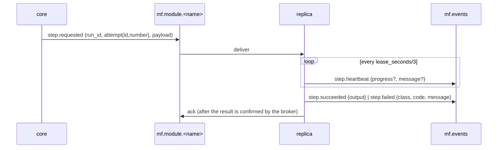

# Протокол модулей (contract 0.2.1)

Документ для авторов SDK и модулей. Машиночитаемая часть:
- `schemas/envelope/v2/envelope.schema.json`: конверт и payload каждого типа;
- `schemas/envelope/v2/blob-ref.schema.json`: ссылка на blob;
- `testdata/envelope/{valid,invalid}`: примеры, которые SDK должен принимать и отвергать так же, как ядро.

Go-реализация лежит в `internal/contract`.

## 1. Окружение модуля

Runtime-драйвер (docker, kubernetes) задаёт эти переменные каждому контейнеру. Для `runtime: external` их задаёт тот, кто запускает модуль.

| Переменная | Пример | Смысл |
|---|---|---|
| `MF_MODULE_NAME` | `hello-hello` | имя ресурса Module |
| `MF_REPLICA_ID` | `hello-hello-0` | уникален среди живых реплик; если не задан, SDK генерирует `<module>-<random>` |
| `MF_AMQP_URL` | `amqp://mod-hello-hello:…@rabbitmq:5672/` | брокер; пользователь брокера равен модулю (в кластере) |
| `MF_CONCURRENCY` | `4` | prefetch = число одновременных шагов в реплике |
| `MF_HEALTH_ADDR` | `:8081` | адрес для `/healthz`, `/readyz` и `/metrics` |
| `MF_S3_ENDPOINT`, `MF_S3_BUCKET`, `MF_S3_ACCESS_KEY`, `MF_S3_SECRET_KEY`, `MF_S3_TLS` | `minio:9000`, `mf-blobs`, …, `false` | хранилище blobs |
| `MF_LOG_LEVEL` | `info` | |
| `OTEL_EXPORTER_OTLP_ENDPOINT` | `http://otel:4317` | необязательно |

Префикс `MF_` зарезервирован: в `spec.env` модуля его использовать нельзя.

## 2. Топология RabbitMQ

| Объект | Тип | Кто объявляет | Назначение |
|---|---|---|---|
| `mf.commands` | exchange direct, durable | ядро | работа модулю, ключ `module.<name>` |
| `mf.module.<name>` | quorum queue | ядро при apply модуля; SDK объявляет повторно с **теми же** аргументами | `step.requested`, `source.trigger` |
| `mf.control` | exchange topic, durable | ядро | `step.cancel`, ключ `control.<name>` |
| `mf.control.<name>.<replica>` | classic queue, exclusive, auto-delete | SDK | привязка `control.<name>`, по одной на реплику |
| `mf.events` | exchange topic, durable | ядро | события модулей, ключ равен `type` сообщения |
| `mf.core.events` | quorum queue | ядро | привязка `#` |
| `mf.dlx` / `mf.dead-letters` | fanout / quorum | ядро | сообщения, исчерпавшие `x-delivery-limit` |

Аргументы quorum-очередей: `x-queue-type=quorum`, `x-delivery-limit=5`, `x-dead-letter-exchange=mf.dlx`.

Свойства публикуемого сообщения:
- `content_type=application/json`;
- `delivery_mode=2` (persistent);
- `message_id` равен `envelope.message_id`;
- `type` равен `envelope.type`.

Публикация идёт с publisher confirms.

## 3. Жизненный цикл реплики

1. Подключиться к брокеру, объявить work-очередь и свою control-очередь.
2. Отправить `module.online`: версия контракта, SDK, `kinds` (`step`, `source`), схемы входа и выхода. Ядро отклоняет другую **мажорную** версию контракта: реплика получает статус `unhealthy`, а в UI появляется причина.
3. Каждые 10 с отправлять `module.heartbeat`. Реплика без heartbeat дольше 30 с считается `down`.
4. Потреблять `mf.module.<name>` с `prefetch = MF_CONCURRENCY` и ручным ack.
5. По SIGTERM:
   - перестать брать новые сообщения;
   - дождаться текущих шагов (не дольше grace-периода);
   - отправить `module.offline` и закрыть соединение.

`/healthz` отвечает 200, пока процесс жив. `/readyz` отвечает 200, пока есть соединение с брокером и consumer запущен.

## 4. Выполнение шага

- **Вход.**
  - `payload.input` — это `data` запуска.
  - Если у шага есть проекция `input`, это объект её вычисленных полей.
  - Для шага `foreach` без проекции: `{"item": <элемент>, "index": <i>, "data": <data>}`.
  - `payload.config` — `spec.config` модуля, поверх которого по ключам наложен `config` шага.
- **Lease.** `step.heartbeat` отправляется не реже `lease_seconds/3`. Если heartbeat нет дольше `lease_seconds`, ядро считает попытку `lost` и может её повторить.
- **Deadline.** После `payload.deadline` результат не нужен: ядро уже перевело попытку в `timed_out`. SDK отменяет обработчик.
- **Результат.**
  - `step.succeeded.output` — JSON-объект.
  - Если в спеке шага `merge: data` (по умолчанию), ядро применяет `output` к `data` как JSON Merge Patch (RFC 7396): `null` удаляет ключ.
  - Выход всегда сохраняется в `steps.<id>.output`.
- **Ошибка.** Поле `step.failed.class`:
  - `transient` — повтор по `retry` (с учётом `retry_after_seconds`);
  - `fatal` — шаг провален, run `failed`, если шаг не `optional`;
  - `attention` — run паркуется в `needs_attention` до решения оператора.
- **Идентификаторы.**
  - `message_id` результата: `uuid5(NS, "<attempt_id>:<type>")`, где `NS = 32e7ee34-6c60-51c1-a912-93b117ba36cd`, то есть `uuid5(NAMESPACE_URL, "https://manufacture.dev/messages")`. Повтор того же результата ядро применит один раз.
  - Для heartbeat-сообщений `message_id` случайный (uuid4).
- **Повторная доставка.** Доставка at-least-once, поэтому `step.requested` с тем же `attempt.id` может прийти дважды. Если попытка уже выполняется в этой реплике, дубль подтверждается (ack) без запуска. Обработчик должен быть идемпотентен в пределах `attempt.id`.
- **Устаревшие попытки.** Результат для попытки, которая уже не текущая (таймаут, отмена, новая попытка), ядро игнорирует.
- **Отмена.** `step.cancel` приходит в control-очередь каждой реплики. Реплика, которая выполняет `attempt.id`, отменяет обработчик и результат не отправляет.

## 5. Source-модули

- `source.trigger` (из work-очереди) значит «создай запуски сейчас». SDK вызывает source-обработчик и на каждый результат отправляет `run.requested {pipeline, data, dedup_key?, trigger_id}`.
- Source может отправлять `run.requested` и сам: при старте или по своему расписанию.
- Ядро дедуплицирует по `(pipeline, dedup_key)`: повтор возвращает уже созданный run.

## 6. Большие данные

- Конверт не больше 256 КиБ.
- Значения больше 64 КиБ (порог SDK, можно менять) и файлы кладутся в S3 под `payload.blob_prefix` (`s3://<bucket>/runs/<run>/<step>/<attempt>/…`). В JSON вместо значения стоит ссылка: `{"$blob": "s3://mf-blobs/runs/…/frames.bin", "size": 73400320, "sha256": "…", "content_type": "application/octet-stream"}`.
- Любой объект с ключом `$blob` — это ссылка. Модуль читает её лениво.
- Писать можно только под свой `blob_prefix`, читать — под `runs/`.

## 7. Совместимость

`schemas/VERSION` хранит семвер контракта. До 1.0.0 минорная версия может ломать совместимость, о таких изменениях сообщается в `CHANGELOG.md`.
